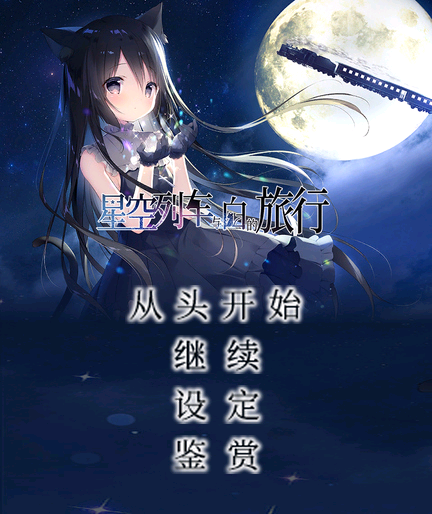
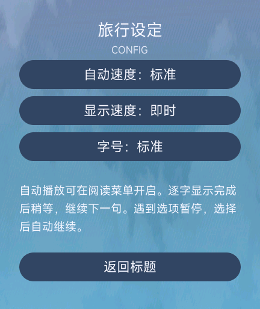

# 星空列车与白的旅行 · REDMI Watch 5

《星空列车与白的旅行》的 Xiaomi Vela 手表阅读版本。将 Windows 版剧情与图像转换为手表资源，提供对白阅读、角色立绘、剧情选择、存档与 CG 鉴赏，界面按 REDMI Watch 5 的 432 × 514 屏幕设计。

本项目参考 **[@liuyuze61](https://github.com/liuyuze61)** 的《ATRI 1.5.1》与《星空列车与白的旅行 v1.0.0》移植作品，完成了本项目的资源转换和播放器功能扩展。两部参考作品的原始链接见「参考作品与致谢」。

> 当前正式版 **0.3.3**（2026-11-03）将包体从 10.49 MB 压至 **9,988,752 字节，约 9.99 MB（9.53 MiB）**。保持立绘尺寸/站位、剧情及所有功能，正文继续左上对齐。32 项自动检查、36 条选择路径与官方原生模拟器检查通过，**维护者于 2026-11-03 确认 0.3.3 已通过 REDMI Watch 5 实机测试**；记录见 `reports/hardware-test-v033.json`。已测试的安装包字节保持不变。

## 0.3.3 接近 10 MB 的压缩

- 相比 0.3.2 减少 **504,844 字节**。保留 17 章、13,765 条对白/旁白、30 槽存档、124 张 CG/24 组差分、自动播放和安全跳章，未删除剧情或图片。
- 149 张立绘从未量化的原图缩放参考重新编码为 96/80 色透明 PNG：84 张使用 96 色，65 张使用 80 色。只采用更小且通过逐张原图误差检查的候选图。黑/灰/白背景合成、主体颜色、透明度及上半部中央区域的均方误差均不高于 0.3.2；尺寸、裁剪框和站位完全相同。
- 其余 **219 张立绘逐字节保留**，其中包括全部 61 张诺瓦普通/近景差分。其他剧情背景和全部 CG 文件也保留原字节；此轮没有降低图片分辨率。
- 标题和菜单两张不透明背景改为原尺寸、非渐进 JPEG，质量分别为 98/95，保留 4:4:4 色度。文字按钮、透明对白框、姓名框、图标保持原 PNG 文件。
- **调色板重编码和 JPEG 均属于有损处理，不是全包无损。** 原图误差检查用于筛选，不能替代所有场景的主观画质判断。原图／0.3.2／0.3.3 的代表立绘对比见 `docs/images/portrait-compare-v033.png`，逐张数据见 `reports/compact-artwork-v033.json`。
- 页面程序仅修改两张背景的文件扩展名。全部公共 JavaScript、17 个剧情文件、存档/选择/自动播放逻辑及正文左上布局与 0.3.2 相同；官方原生模拟器覆盖升级前后存档数据库字节一致。
- 本版原生检查覆盖新 JPEG 标题/设定背景、旧档、短句/换行、逐字位置、两档字号、长文滚动和换句回顶部，完成后恢复原章节进度，未覆盖存档。记录见 `reports/final-validation-v033.json`、`native-test-results/v033/`。普通应用检查不代表所有设备、固件长期零异常。

开发与整理由 **OpenAI Codex** 完成。自编代码 MIT，原作素材按其原有权利处理。


## 0.3.2 剧情正文左上对齐（已通过实机测试）

- 去掉正文预留的固定/最小高度，正文按实际内容向下增长；文本区保持左上对齐，正文左对齐并自动换行，不再从中间向两边或上下扩展。
- 白字、标准/大字号与原始段落保留。长文本超过可视区域仍可滚动；换句时用 `scrollTo({top:0})` 回到顶部，防止继承上一段的滚动位置。
- 在官方原生模拟器检查旧档读取、短句、自动换行、逐字显示前后位置、两档字号、长段落滚动与换句回顶。测试完成后恢复原章节进度，没有写入或覆盖存档。详见 `native-test-results/v032/`。
- 575 个运行资源与 0.3.1 逐字节相同，17 个剧情文件、立绘、CG、图标和界面图片均未重新编码；剧情/选择、存档、自动播放与 CG 引擎未修改。已有 32 项自动测试及全部 36 条选择路径检查通过。

维护者于 2026-11-03 确认 0.3.2 实机测试通过，记录见 `reports/hardware-test-v032.json`。开发与整理由 **OpenAI Codex** 完成。


## 0.3.1 画面、文本与体积优化（历史记录）

- 重新裁取原作设定背景，去除底部桌面版深色横条；正文上方不再显示 `1 / 17` 等章节计数。旁白隐藏空白姓名底条，正文保持白色。
- 全量检查 13,765 条对白/旁白、10 条选项文本和人物名，清理 1,517 处段首缩进、全角/重复空格等显示空白。保留可见文字和段落，以及全部指令、跳转、选项目标和原存档游标；旧档预览显示时也清理缩进。
- 368 张立绘采用原作 Character 表的默认 X/Y、Scale 与中心轴，以 1280 × 720 原画布的同一比例映射到手表。普通与近景立绘保留原有差异；沿用静态单人显示，不代表完整复现原作多人调度与动画。
- 参考命运石之门 0、命运石之门及 CLANNAD 的资源处理方法：PNG 无损编码搜索，背景/CG 从原图转为原尺寸非渐进 JPEG。132 张 JPEG 仅在更小、且相对原图的 RGB 均方误差不高于此前调色板 PNG 时采用。**JPEG 属于有损编码**；该指标不等于逐像素一致或所有场景下观感相同。
- 为继续满足 10.5 MB 以内限制，368 张立绘只裁掉透明留白，显示时恢复原坐标；逐张还原后的 RGBA 像素与裁剪前一致。完全重复的图片共用文件，剧情文件改用标准 ZIP DEFLATE 的更紧凑编码。此轮没有继续降低颜色数、分辨率或 JPEG 质量。
- 保留 17 章、全部 124 张 CG/24 组差分、30 槽存档、三档自动播放及安全跳章。剧情、存档和 CG 引擎保持 0.3.0 的实现，所有 36 条选择路径正常阅读与跳章结果一致。原生覆盖升级前后存档数据库字节一致，旧槽读取成功。
- 检查记录：`reports/final-validation-v031.json`、`reports/portrait-layout-v031.json`、`reports/portrait-crop-v031.json`、`reports/text-whitespace-v031.json`、`reports/lossless-png-v031.json`、`reports/opaque-compression-v031.json`、`reports/package-compression-v031.json` 和 `native-test-results/v031/`。

开发与整理由 **OpenAI Codex** 完成。原作素材不属于 MIT 代码授权范围。


## 0.3.0 原作风格 UI 与自动播放（历史记录）

- 使用用户提供原作的中文标题按钮「从头开始／继续／设定／鉴赏」，按手表竖屏重新安排星空、月亮、列车与角色封面。应用列表仍使用已验证的圆形图标。
- 阅读区采用原作淡紫色条纹与星光对白框、姓名底条，**正文为白色**，章节与选项提示为浅色。菜单、设定、存读档、选项、翻页及 CG 鉴赏统一原作的云层与蓝灰色圆角按钮。
- 阅读菜单开启「自动播放」，选择「返回游戏」继续。自动模式按约 30 毫秒一字显示，完成一句后等待：慢速 2.6 秒、标准 1.5 秒、快速 0.8 秒；超过 60 字按字数延长，额外时间最多 5 秒。开启时已完整显示的当前句先等待，后续句子逐字显示；手动显示速度独立保留。
- 遇到选项必须由玩家选择，之后自动继续。菜单、存读档、正文触摸/滚动与后台期间暂停，返回正文后重新计时；手动补全当前句会重新等待。上一句、返回标题、剧情结束或报错关闭自动播放；每次启动默认关闭，只保存速度档位。
- 保留 30 槽存档及原有键/格式。0.2.7 在原生界面生成的旧存档、设置数据库，在安装 0.3.0 前后字节一致；新版实际读取成功，另检查保存至第 30 槽。
- 原有 568 个运行资源逐字节一致，剧情、原图、立绘、CG、分组和安全跳章引擎没有修改；两种阅读方式的全部 36 种选择路径结局一致。4 组选项逐一检查自动暂停、手动选择后继续与跳章保护。
- 原生检查覆盖新标题/设定按钮、旧档、自动播放、选项保护、字号、存档第 30 槽、CG 差分及全部 6 页目录。详见 `reports/final-validation-v030.json`、`reports/original-ui-v030.json` 与 `native-test-results/v030/`。

本次开发由 **OpenAI Codex** 完成。原作 UI 素材与游戏资源不属于 MIT 代码授权范围。


## 功能与本项目成果

- **人物与场景显示**：对白、角色立绘、背景与 CG 配合呈现，按手表屏幕缩放资源。
- **剧情分支**：17 章、13,765 条对白/旁白、10 条选项文本，保留 4 组选项及对应分支。
- **30 个存档栏位**：保存和加载均可自行选槽，覆盖前确认；支持从标题加载和旧版单槽存档兼容。
- **自动播放**：菜单开关与三档速度，选项由玩家选择，菜单、存读档、滚动及后台暂停。
- **安全下一章**：从当前进度按原剧情快进，到首个待选选项立即停止；选项界面再次跳章会返回原选项，必须自行选择。没有待选选项时停在下一章开头或本篇结束。已选分支、变量与存档格式保持一致。
- **分组 CG 鉴赏**：标题直接进入，124 张 CG 按场景整理为 24 组。同场景差分只占一个列表项，打开后点击画面切换下一张，支持前后组切换及返回原列表页。
- **资源读取与内存处理**：只缓存正在阅读的一章，限制历史记录；当前包使用透明 PNG、非渐进 JPEG 和内容为 JSON 的 UTF-8 TXT 剧情资源。
- **图标与名称修复**：用角色封面替换应用列表的单色占位图标，图标为 192 × 192 PNG；应用名使用完整游戏名称。

CG 鉴赏中的转换资源全部开放，可能提前展示后续剧情。

## 开发工具与分工

本项目的程序实现、资源转换、图像处理、手表界面适配、测试工具及文档整理由 **OpenAI Codex** 在维护者的需求与反馈指导下完成。维护者负责提出需求、提供原版资源、审查成果及完成 REDMI Watch 5 实机测试。

## 画面预览

| 标题背景 | 立绘与逐字显示 | 设定背景 |
| --- | --- | --- |
|  |  |  |

以上为最终 0.3.3 包在官方原生模拟器中的截图。正文从左上第一行开始，长段落可滚动。

## 当前安装包

[下载 0.3.3 正式版、源码、安装说明和校验文件](https://github.com/xuanyide01/starry-rw5/releases/tag/v0.3.3)。完整版本目录见 [RELEASES.md](RELEASES.md)。

本地副本位于 `../最终交付/0.3.3/`；已测试的 0.3.2 同样保留。

[旧版 0.2.7 实测正式发布及校验文件](https://github.com/xuanyide01/starry-rw5/releases/tag/v0.2.7)。

| 项目 | 内容 |
| --- | --- |
| 应用名称 | 星空列车与白的旅行 |
| 版本 | 0.3.3 / versionCode 14 |
| 包名 | `com.codex.starry.rw5` |
| BIN 文件 | `starry-rw5-v0.3.3.bin`（本地中文文件名与其内容相同） |
| 文件大小 | **9,988,752 字节，约 9.99 MB** |
| 包内文件解压总大小 | 11,535,084 字节，不含安装工具额外开销 |

MB 按 1,000,000 字节计算。BIN 与同版本 RPK 内容相同，任选安装工具支持的格式。当前产物使用开发签名。

```text
SHA256
7876e4d5319536688682a65d5d1273304b46a3a992a81d9fc492d14a36bb18af
```

## 安装与使用

1. 使用支持 REDMI Watch 5 的 Vela 应用安装工具安装对应 BIN；已有实机测试使用「表盘自定义工具」（相关社区：[米坛社区 BandBBS](https://www.bandbbs.cn/)）。
2. **工具显示安装完成后，仍需等待一阵，手表端才会完成安装。** 等待应用与图标在列表中正常显示，再打开游戏；不要刚看到完成提示就反复重装。
3. 在应用列表打开“星空列车与白的旅行”，选择从头开始、继续、设定或鉴赏。
4. 阅读时打开菜单，选择保存、加载、下一章或自动播放。保存时选定栏位；加载时自行选择所需栏位。
5. CG 列表选择场景，打开后点击图片循环切换差分。

包名和存档键保持不变。覆盖安装是否保留数据取决于安装工具，卸载可能清除存档；更新前请保留旧安装文件并记录版本。

## 0.2.6 跳章修正

新包在官方 Vela 虚拟手表安装、启动和菜单选项保护检查通过；仍使用已通过此前实机测试的资源格式与兼容编译器，未改动图片和剧情文件。36 种选择组合在正常阅读与安全跳章下的结局状态一致。

## 0.2.7 圆形图标

应用列表图标使用 192 × 192 RGBA PNG，圆外透明，移除图内标题文字。游戏标题背景继续使用原画。新包的页面脚本及除图标外的全部资源与 0.2.6 相同，签名与文件摘要校验、原生安装及启动检查通过。


## 适配与验证

目标设备为 **REDMI Watch 5**，已有测试设备信息为 M2427W1、系统 3.100.105。**小米手环 8 Pro 尚未适配。**

- **0.3.3 已通过 REDMI Watch 5 实机测试**，依据维护者于 2026-11-03 的反馈。包体 9,988,752 字节，实机通过后未重建或修改安装包；本次反馈未另行提供固件版本。
- 本次确认与原生模拟器记录分开保存：`reports/hardware-test-v033.json` 为维护者实机反馈，`native-test-results/v033/` 为开发环境检查。

- 0.3.1 共 32 项自动测试通过，新增原作立绘坐标、透明裁剪边界、全量文本空白与界面移除项检查。0.3.0 的 26 项检查继续通过，新增实际页面的自动播放定时、4 组原始选项、后台、滚动、旧设置与存档兼容检查。原有 13 项自动测试继续通过，包含原始剧情/资源、30 槽保存、CG、TXT 读取及安全跳章。检查 17 个章节入口，快进后的选项、变量与调用栈与正常阅读一致。
- 0.2.4 在官方原生模拟器中通过 17 章逐一读取、全部 6 页 CG 列表、代表场景差分循环及旧存档加载检查。
- 0.2.5 通过原生模拟器安装、启动、应用名称与图标资源检查；游戏代码和剧情图像资源与 0.2.4 逐字节相同，已有模拟器存档数据库未发生变化。
- **0.2.5 已完成 REDMI Watch 5 上机测试，应用图标正常显示，目前各项功能暂未发现异常。** 此项依据维护者于 2026-10-09 提供的实机反馈记录。

原生环境使用官方 `vela-watch-5.0` 镜像，并非实机系统 3.100.105 的完整复刻。实机与模拟器检查的范围以已测试设备和已检查内容为准，尚未覆盖所有设备、固件及长期运行情况。

## 开发与构建

在 Windows 的项目根目录执行，需 Node.js 与 npm，并已准备好 `src/common/` 下的转换资源：

```powershell
npm ci
python -m pip install -r requirements.txt
npm install --prefix tools/compat-toolkit --ignore-scripts
npm test
npm run release
python tools/compress-package.py dist/com.codex.starry.rw5.debug.0.3.3.rpk --work .package-cache
```

产物为 `dist/com.codex.starry.rw5.debug.0.3.3.rpk`。构建固定使用 **aiot-toolkit 1.1.0**，`tools/compat-toolkit` 将图片依赖 sharp 固定为 0.34.5；项目根目录的 2.0.5 依赖用于开发和模拟器工具。构建脚本检查 **25,000,000 字节**通用上限；本次最终交付另校验 **10,000,000 字节**上限。生产构建的 `quickapp.config.js` 保留源 PNG/JPEG 字节，防止工具链额外改变图片。紧凑封装需 Python、zopfli，使用相同开发证书重新签名。

```text
src/                  Vela 应用、界面与转换后的运行资源
tools/                原版资源提取、转换、构建和模拟器工具
tests/                自动测试
native-test-results/  带实际版本号的原生检查记录
docs/images/          README 截图
```

若仓库只公开程序代码和工具，需先准备原版资源的转换结果，再构建。`extract-original.py`、`export-images.py` 针对本次 Unity/Utage 资源版本；目前并非任意 Galgame 的一键转换器。旧 `compress-images.py` 属于 0.2.2 的 JPEG 方案，请使用 0.3.1 的逐张筛选工具，避免覆盖透明立绘。

### 原生模拟器与 UI 素材

可使用现有官方 SDK：设置 `WATCH_SDK_HOME`、`STARRY_EMULATOR_HOME`、`WATCH_ADB_PATH`，并通过 `NODE_PATH` 或项目依赖提供 `@aiot-toolkit/emulator`。先运行 `node tools/setup-ui-emulator.cjs`，再运行 `node tools/emulator-server.cjs`。默认创建专用 `StarryUI20261103`，使用 emulator-5608、HTTP 43187、gRPC 8608，避免与其他项目共用设备。启动前检查端口是否空闲。

原生预览入口为 `http://127.0.0.1:43187/`，接口 `/install?rpk=<安装包绝对路径 URL 编码>`、`/start`、`/screen`、`/shutdown` 用于安装、启动、截图与关闭专用设备。`tools/native-ui-v031.cjs` 为历史完整功能测试，会读取第 1 槽并写第 30 槽；0.3.2 排版检查使用 `tools/native-text-layout-v032.cjs`，读取第 29 槽（第 2 章、游标 120），不写存档，但会临时切换阅读位置和显示设置。仅对独立测试设备运行。

0.3.1 原生测试使用已在界面生成的 0.2.7 存档作为测试起点；测试未改动真实手表。官方模拟器不是实机固件的完整复刻。新 UI 与自动播放仍待上机复测。

已有 `src/common/ui/` 足够构建，重提取原作 UI 可安装 `requirements.txt` 后运行：

```powershell
python tools/build-original-ui.py --game-data '原游戏的 *_Data 目录'
```

立绘导出工具为 `tools/build-original-portraits.py`；需要重新处理素材时，先按原作生成全画布立绘与 UI，再依次运行 `compress-png-lossless.py`、`compress-opaque-images.py`、`compress-portraits-lossless.py --apply` 和 `deduplicate-images.py`。这些脚本的 `--work` 目录用于备份与缓存；无损首轮或裁剪已完成后不要在同一基线上重复应用。当前资源已完成处理，直接构建即可。0.3.3 的额外压缩使用 `portrait-palette-candidates.py --rgba-reference <未量化参考图目录> --work <缓存目录>` 与 `compact-artwork-v033.py --candidates <候选 JSON> --work <备份目录>`；需以保留的 0.3.2 资源基线重新运行，不能在已重编码的立绘上反复量化。未量化参考图可用 `build-original-portraits.py --reference-only --rgba-reference <目录>` 从用户提供的原作重新导出。

该工具只读原作场景纹理，按相同规则生成标题、云层底图、对白和按钮；只适用于本次原作版本。安装包审计可执行 `node tools/audit-package.cjs`，覆盖 ZIP CRC、内外 RSA 签名和所有文件摘要。

## 已知限制与异常处理

当前不含原版音乐、配音、视频、复杂动画及完整多人立绘站位。Windows 原版引擎没有在手表上运行，图像经过缩放和压缩。

应用无响应但系统仍能操作时，退出后重新打开并加载最近手动存档。整个手表无响应时，按[小米官方电源键说明](https://www.mi.com/global/support/faq/details/KA-524524/)长按约 **18 秒**，出现标志后松开。黑屏无法启动时，参考[官方 FAQ](https://www.mi.com/uk/support/faq/details/KA-521474/)使用原配充电座充电至少 10 分钟，再尝试强制重启；仍无法恢复则联系售后。

本应用只声明 `system.storage`、`system.file`、`system.prompt`，不包含固件或系统分区写入代码。包体限制和现有检查不能保证所有设备零崩溃。反馈问题时请提供设备型号、系统版本、应用版本、章节及复现步骤。

## 参考作品与致谢

感谢 **[@liuyuze61](https://github.com/liuyuze61)** 的手表移植作品，它们为应用结构、剧情资源组织及兼容性研究提供了参考：

- **ATRI 1.5.1**，作者 @liuyuze61：[原作品分享链接](https://api.bandbbs.cn/wftools/bandbbs.html?code=A&state=1820673)。
- **星空列车与白的旅行 v1.0.0**，作者 @liuyuze61：[原作品分享链接](https://api.bandbbs.cn/wftools/bandbbs.html?code=A&state=1841662)。
- 作者相关开源项目：[ATRI-miband](https://github.com/liuyuze61/ATRI-miband)。
- 平台开发资料：[Xiaomi Vela JS 应用官方文档](https://iot.mi.com/vela/quickapp/)。

表盘分享链接保留原分享地址，需要浏览器或「表盘自定义工具」访问。也感谢原作开发者、译者、开源工具作者及参与实机反馈的测试者。

感谢 **「表盘自定义工具」的开发者及相关团队**提供安装工具，支持本项目的应用安装与实机测试。相关社区：[米坛社区 BandBBS](https://www.bandbbs.cn/)。

## 原作官网

《星空列车与白的旅行》：[しらたまこ官方网站](https://shiratamaco.com/)。

## 许可证与游戏资源

本项目自行编写的程序代码采用 [MIT 许可证](LICENSE)。第三方代码保留原许可证和署名；参考项目许可见 [ATRI-miband-LICENSE](licenses/ATRI-miband-LICENSE)。

原版剧本、立绘、CG、背景和标识属于相应权利人，不纳入本项目代码许可证。含有这些素材的完整安装包也不能仅凭代码的开源许可获得素材分发授权。MIT 许可只覆盖程序代码，原作素材的使用和分发仍受相应权利人的授权约束。请支持原作。

## 相关项目

[夏日口袋 · REDMI Watch 5](https://github.com/xuanyide01/summer-rw5)。


## 联系方式

问题反馈与交流：[shining237841@gmail.com](mailto:shining237841@gmail.com)。
